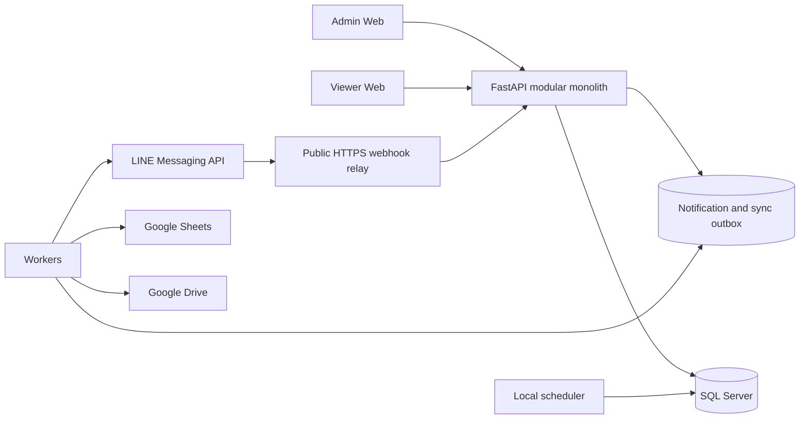
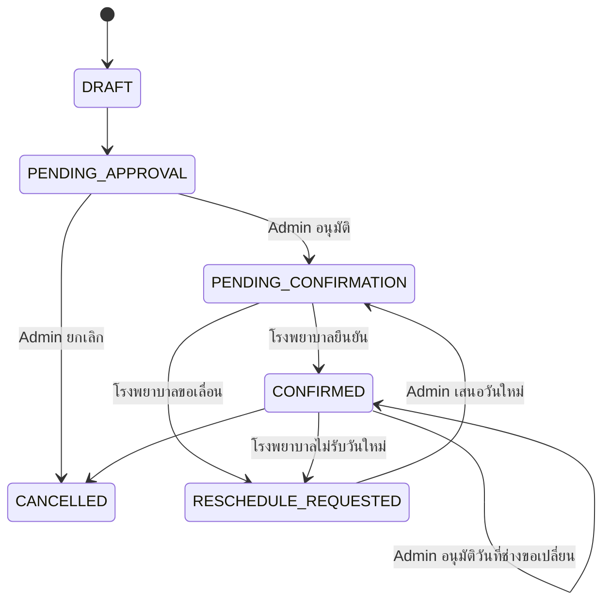

# สถาปัตยกรรมระบบ

## ขอบเขตข้อมูล

SQL Server/BA_PMnotification เก็บสถานะธุรกิจที่ commit แล้วทั้งหมด Google Sheets รับข้อเสนอการแก้ไขและแสดงรายงาน Google Drive เก็บไฟล์ต้นฉบับด้วย stable file ID LINE ใช้รับข้อความและตอบรับนัดผ่าน webhook ที่ตรวจ signature แล้ว

## โมดูล

- Master Data ดูแลโรงพยาบาล aliases ผู้ผลิต ประเภทอุปกรณ์ อุปกรณ์ และช่าง
- Draft Review เก็บข้อมูลไม่รู้จักโดยไม่สร้าง master data จริงอัตโนมัติ
- PM Planning สร้างแผนรายปีและ PM Slots ใน transaction เดียว
- Intake ใช้ pipeline เดียวกันสำหรับ LINE text, Excel, Drive และ web upload
- Matching จำกัด equipment match ภายในโรงพยาบาลและให้คะแนน Slot แบบ advisory
- Appointment Workflow บังคับ state transition ที่ backend และเก็บ revision แบบ append-only
- Notification Outbox claim งานด้วย row lock, idempotency key และ bounded retry
- Google Sync รับ staged input พร้อม expected version และ export reporting projections
- Audit เก็บ actor, source, before/after, reason และ revision

## Appointment state

การเปลี่ยนวันโดยช่างหลังยืนยันจะเปลี่ยน `current_revision_id` และคง `confirmed_revision_id` เดิม สถานะยังเป็น `CONFIRMED` พร้อมแสดงว่า Admin เปลี่ยนวัน และโรงพยาบาลยังขอเลื่อนได้

## Transaction boundaries

- อนุมัติแผน สร้าง Annual Plan และ Slots ทั้งหมดใน transaction เดียว
- อนุมัตินัด ล็อก Slot ตรวจ version สร้าง appointment, revision, token, audit และ notification job ใน transaction เดียว
- Bulk approval ใช้ savepoint ต่อ draft เพื่อรายงานผลรายรายการ
- Worker claim งานด้วย SQL Server row lock hints

